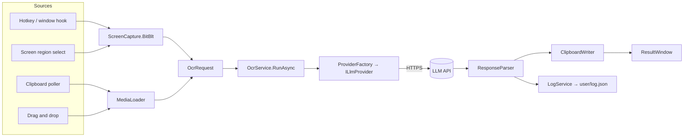
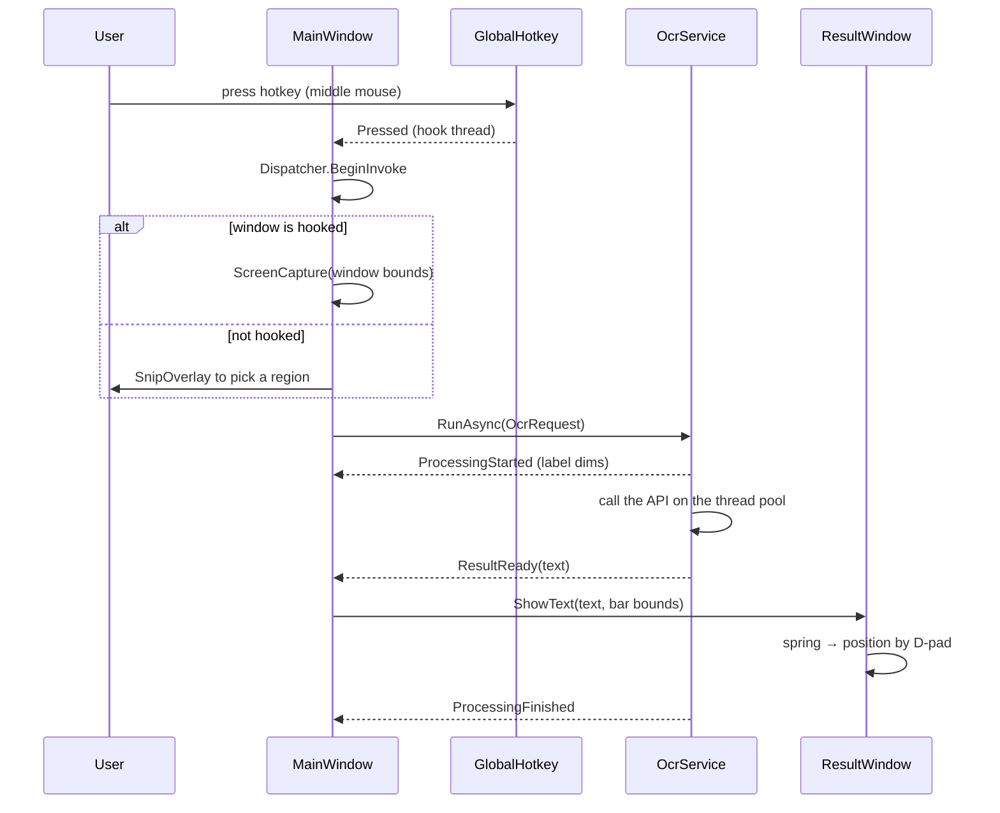

# YuukaOCR — Project structure

> A rewrite of `img-to-text` (Python/PySide6) in **C# / .NET 10 + WPF**.
> This document explains *what lives where* and *why* it lives there.

---

## 1. Overview

```
YuukaOCR.slnx                     # solution (2 src projects + 1 test project)
Directory.Build.props             # shared Nullable, ImplicitUsings, LangVersion
PROJECT_STRUCTURE.md              # this file
README.md                         # user-facing introduction
config/app_configs.json           # static configuration (not user data)
user/                             # user data (gitignored): settings.json, log.json, .env, ui.png
src/
  YuukaOCR.Core/                  # pure logic, does NOT reference WPF
  YuukaOCR.App/                   # WPF: windows, theme, controls
tests/
  YuukaOCR.Tests/                 # hand-rolled test runner (no NuGet needed)
tools/
  xamlcheck/                      # CLI smoke test: parses every XAML file, builds the result bubble,
                                  # then measures layout (thumb clipping, tick ink, input heights)
```

The two layers are separated by a **one-way project reference**: `App → Core`.
`Core` knows nothing about WPF, so everything that is easy to get wrong (parser, physics, hooking,
providers, file loading) is testable without opening a window.

---

## 2. YuukaOCR.Core

### 2.1 Root

| File | Responsibility |
| --- | --- |
| `AppPaths.cs` | The single place that decides paths. `Root` walks up from `AppContext.BaseDirectory` looking for a folder with both `config/` and `src/` (dev mode), otherwise it uses the exe folder (publish mode). |
| `Json.cs` | Shared `JsonSerializerOptions` (indented, case-insensitive, comments skipped). |
| `Rgba.cs` | RGBA colour + parsing of `#RGB`, `#RRGGBB`, `#AARRGGBB`, `rgba(...)`. |

### 2.2 `Settings/`

| File | Responsibility |
| --- | --- |
| `AppConfig.cs` | Contents of `config/app_configs.json`: default UI image, maximum file size, accepted extensions, default prompt/hotkey. Has `Save()`. The button colours moved into the theme palette, so a preset switch cannot leave a stray pill behind. |
| `AppSettings.cs` | User settings (`user/settings.json`): window position per monitor configuration, UI scale, physics, hooking (+ `hook_mode`), hotkey, provider/model, UI language, clipboard flags, OCR prompt (`custom_prompt`), theme, `agent`, `actions`. `Normalize()` snaps every slider-backed value onto its tick grid (via `SliderSpecs`), repairs `hook_mode`, and normalizes the agent block and the action table. |
| `SliderSpecs.cs` | The **one table** of slider ranges: `SliderSpec(key, min, max, step, default, decimals)` with `Snap` / `IsOnGrid` / `Format`, plus `SliderSpecs.All/Get/TryGet/Snap/Default`. The settings window binds every slider to it (`Ui/Controls/SliderSetup`), and `Normalize()` snaps stored values with it — so the range on screen and the range the clamp accepts cannot disagree, and every default sits exactly on a tick (a test asserts it). Two groups changed in this round: `BackgroundOpacity` now ships **90** (still only for a file without the key), and the five *Window edge snapping* sliders halved their steps — `HookProximityTop/Bottom` 50, `HookOffsetTop/Bottom` 25, `UnhookDistance` 50 — so they carry twice the ticks over the same range while every value an older build could store stays on the grid. |
| `AgentSettings.cs` | The agent's own settings: `Instruction` (persona/system prompt), `Provider`, `Model` (empty = follow the OCR configuration), `Temperature`, `ContextTokens` (history budget) + `Normalize()`/`Clone()`. |
| `SettingsStore.cs` | Load/save + raises `Changed`. Writes are debounced by 700 ms so dragging a slider does not produce 60 file writes. |
| `ThemeSettings.cs` | Appearance choices: the active `preset`, `frame_opacity`, `background_opacity`, font family + size. `Normalize()` repairs a hand-edited file (unknown preset → default, opacity and font size **snapped to their slider ticks**), and `Bar`/`Background` fold the opacities into the palette colours. |
| `ThemePreset.cs` | `ThemePalette` (the 11 colours a window actually paints) and `ThemePresets` (the table of 8 looks). A preset authors only 5 colours — bar, accent, close, background, text — and the panel/hover/border steps are derived from the background brightness, while bar and accent text is derived from the surface luminance. One row here = one new theme. |
| `WindowPosition.cs` | `X/Y` pair used by the `Positions` dictionary. |

### 2.3 `Providers/`

| File | Responsibility |
| --- | --- |
| `ProviderInfo.cs` | `record` describing one provider: `Id`, `DisplayName`, `BaseUrl`, `Kind`, `EnvKey`, `DocsUrl`, `SupportsVision`, `RequiresKey`, `DefaultModel`, `SuggestedModels`, `Note` (a translation key, resolved through `NoteText`), `AuthCheckPath` (an authenticated endpoint used to test a key — set only where the model list is public, e.g. OpenRouter's `/key`). |
| `ProviderRegistry.cs` | **Data table** of 20 providers (2026). Adding a provider = adding one row here, no other code changes. |
| `ILlmProvider.cs` | Contract: `GenerateAsync`, `ListModelsAsync`. |
| `HttpProviderBase.cs` | Builds the `HttpClient`, folds HTTP failures into `LlmResponse.Fail`, never throws out. `ValidateKeyAsync` defaults to the model list and falls back to `AuthCheckPath` when a provider serves that list without auth. |
| `OpenAiCompatibleProvider.cs` | OpenAI wire protocol (`/chat/completions`, `image_url` data URI). Used by 15+ providers. |
| `GeminiProvider.cs` | Gemini wire protocol (`:generateContent`, `inline_data`). |
| `AnthropicProvider.cs` | Anthropic wire protocol (`/messages`, `image`/`document` blocks). |
| `ProviderFactory.cs` | `ProviderInfo.Kind` → implementation. |
| `ApiKeyPool.cs` | Reads/writes `user/.env`, supports several keys (`OPENAI_API_KEY`, `OPENAI_API_KEY_2`...), rotates them, masks them when displayed. |
| `LlmTypes.cs` | `LlmRequest`, `LlmResponse`, `ModelListResult`. `ModelListResult` carries the HTTP `StatusCode` so callers can tell a rejected key (400/401/403 → `IsKeyRejected`) apart from a timeout or a dead connection without parsing the message. |
| `ModelRanking.cs` | Orders the returned model list: **OpenRouter `@preset/...` entries first**, then vision, then free. Presets are not part of `/models` — they only arrive from the user's history — so the sort is what keeps them at the top of the picker. |

### 2.4 `Ocr/`

| File | Responsibility |
| --- | --- |
| `OcrRequest.cs` | One unit of work: source (`ImageClipboard`, `FileClipboard`, `TextClipboard`, `HookedRegion`, `FileDrop`), bytes + mime, or inline text. |
| `Prompts.cs` | 3 base prompts (image / file / text) + `PromptBuilder`, which merges in the custom prompt. |
| `ResponseParser.cs` | Turns the model's answer into text: plain JSON, JSON wrapped in ```, JSON truncated by the token limit, JSON nested inside a string, or prose. |
| `OcrService.cs` | Pipeline: pick provider + key → build prompt → call the model (async) → parse → write clipboard → record statistics. Raises events for the UI. |
| `MediaLoader.cs` | File → bytes/mime/text. Checks extension and size limit. |

### 2.5 `Agent/` (the result window's chat and action buttons)

| File | Responsibility |
| --- | --- |
| `AgentAction.cs` | One registered action: `Id`, `Name`, `Icon` (a **key**, never a WPF object), `Instruction`. `AgentActions` holds `Max = 10`, the icon whitelist, `NormalizeIcon`, `NewId()` and the three seeds a brand-new settings file starts with. |
| `AgentPrompts.cs` | Pure composition, no I/O: `ChatTurn`/`AgentReply`, `TokensOf` (≈4 chars per token), `SystemPrompt(instruction, context?, label?)`, `TrimHistory(turns, budget)` and `ComposeAction(instruction, label, context)`. Trimming drops the oldest turns first and truncates a single oversized turn instead of losing it. |
| `AgentPreset.cs` | The action preset file: `Export(actions, timestamp)` / `Import(json)` → `PresetResult(Success, Actions, ErrorKey, ErrorArg)`, `Format = "yuukaocr.actions"`, `Version = 1`, `SuggestedFileName()`. Total parsing — every failure is a localization key, never an exception, and nothing is returned unless the whole document is valid. Ids are deliberately not exported (a preset is content; the importer mints fresh ones). |
| `AgentService.cs` | The conversation itself: one `SemaphoreSlim` gate, the shared history (restored from `user/log.json` on construction), `AskAsync` (chat box) and `RunActionAsync` (action buttons), provider/key/model resolution per request, `ThinkingChanged` / `HistoryChanged`, `ClearHistory`, `RemoveTurn`. Chat turns put the OCR context in the **system** prompt; an action turn puts its instruction + context in the **user** turn, so the text is never sent twice. An empty agent model follows the OCR model *only* while the agent also follows the OCR provider — a model id belongs to one provider. |

### 2.6 `Interop/` (Win32)

| File | Responsibility |
| --- | --- |
| `NativeMethods.cs` | All P/Invoke (user32, kernel32, gdi32, dwmapi, shcore) + structs + constants. One file so it stays auditable. |
| `WindowTracker.cs` | Finds the window to snap to: filters top-level windows, skips system processes, checks that the window is really on top at its centre, computes the target for the top/bottom edge. `HookMode { Outside, Inside }` decides whether the bar lands just past the outer edge or along the inner edge, and every target is clamped into the monitor work area so a fullscreen app cannot push the bar off-screen. `ParseMode`/`SerializeMode`/`NormalizeMode` map the stored `hook_mode` string. |
| `ScreenCapture.cs` | BitBlt → top-down BGRA buffer. |
| `ScreenGeometry.cs` | Enumerates monitors, work area, DPI scale, `DisplayConfigHash()` (sha256 of the layout). |
| `WindowMover.cs` | Positions the window in **physical pixels** (`SetWindowPos`), hidden from Alt+Tab. |
| `ClipboardWatcher.cs` | Polls `GetClipboardSequenceNumber` on a background timer; `SuppressNext()` skips the copy the app itself just made. |
| `ClipboardWriter.cs` | Writes text to the clipboard with retries (the clipboard is a shared lock). |
| `AutoStart.cs` | Enables/disables start-with-Windows through `HKCU\...\Run`. |

### 2.7 `Localization/`

| File | Responsibility |
| --- | --- |
| `L.cs` | The one translator: `L.T(key)` / `L.F(key, args)` lookups, `L.Use(code)` switches language and raises `Changed`, `L.Tables` maps a code to its dictionary, `L.Languages` lists the selectable options, `L.Default = "en"` (English first in the menu). Missing keys and unknown language codes fall back to English, so a forgotten key never shows a blank label. Adding a language = one `StringsXX.cs` + one entry in `Tables` + one in `Languages`. |
| `StringsEn.cs` | English table — the **reference set**: every other table must hold exactly these keys. |
| `StringsVi.cs` | Vietnamese table — the original text, kept verbatim; it also keeps the playful "senpai" tone the English table mirrors. |
| `StringsJa/Ko/Zh.cs` | Japanese, Korean, Simplified Chinese. |
| `StringsEs/Fr/De/Ru/Pt.cs` | Spanish, French, German, Russian, Portuguese (Brazil). |

The eight extra tables exist because the language menu offers them; the test runner enforces the key
set for **every** registered table (and that each one really differs from English, so a copy-paste
stub cannot pass), plus that every offered language has a table and vice versa.

`YuukaOCR.App/Ui/Localization/TrExtension.cs` exposes the table to XAML as `{ui:Tr key}`. Because XAML
resolves it at load time, switching language rebuilds the settings window (`MainWindow.Relocalize`
reopens it on the tab the user was on) instead of re-binding every label.

### 2.8 Everything else

| File | Responsibility |
| --- | --- |
| `Input/HotkeySpec.cs` | Parse/format hotkeys (`middle`, `x1`, `ctrl+shift+m`). |
| `Input/VirtualKeys.cs` | Token ↔ virtual-key table. |
| `Input/GlobalHotkey.cs` | Dedicated thread + message pump + low-level hook (keyboard **or** mouse). |
| `Logging/LogService.cs` | Console stream, API/source statistics, recent outputs/prompts, the agent's chat history (`AddChatTurn` / `GetChatHistory` / `RemoveChatTurn` / `ClearChatHistory`). Coalesced 1.5 s file writes. |
| `Logging/ActivityLog.cs` | JSON model of `user/log.json` (`api_calls`, `recent_outputs`, `recent_prompts`, `chat_history`, …). `MaxChatEntries = 200`. |
| `Logging/ApiTrace.cs` | Opt-in request/response trace to `user/api-debug.log`, enabled only by `YUUKA_API_DEBUG=1` (anything but `0`/`false`). Off by default so a shipped build carries no payloads; `build.ps1` deletes stray trace files. |
| `Physics/SpringMotion.cs` | Spring integration with a fixed 16 ms step + edge clamping + bounce. |
| `Update/AppVersion.cs` | Lenient 4-component version (`v2.1.0`, `2.1`, `2.2.0-beta.1`, `2.2.0+build.7`), `TryParse`, `From(Version)`, `IComparable`. A tag that does not parse is never "newer". |
| `Update/GitHubUpdateService.cs` | The release-based updater: `CheckAsync` (`GET /repos/{owner}/{repo}/releases/latest`), `Interpret(json)` (pure, so the test runner can feed it documents), asset pick (`*.zip` containing `win-x64`), `DownloadAsync` with `Progress<double>`, zip validation, `InstallerScript` + `Install` (unpack → drop the package's `user/` → overwrite → restart). Also `TryParseRepository` (https and `git@` remotes) and `IsCheckout`. |
| `Update/GitUpdateService.cs` | `git fetch/rev-parse/pull --ff-only`, stash before pulling, restore the stash if the pull fails; `RemoteUrl`/`IsCheckout` read `.git/config` without spawning git. Kept as the *development checkout* update path. |

---

## 3. YuukaOCR.App (WPF)

| File | Responsibility |
| --- | --- |
| `App.xaml(.cs)` | Startup: `EnsureDirs`, single-instance mutex, global exception handling, create `AppServices`, open `MainWindow`. The `--config` flag opens the settings window directly. `CheckForUpdatesAsync` runs after the bar is up (off the UI thread, never blocking startup) and reports a newer release once per version through the bar; `CheckApiKeyAsync` runs after the bar is up and opens *Settings → System* when the selected provider has no key or the provider rejects it — only a real rejection (`IsKeyRejected`) prompts, never a timeout, and providers that need no key are skipped. |
| `app.manifest` | PerMonitorV2 (critical: without it, physical coordinates and DIP drift apart on monitors scaled ≠ 100%). |
| `Services/AppServices.cs` | The only place that creates `AppConfig`, `SettingsStore`, `LogService`, `OcrService`, `AgentService`, `ClipboardWatcher`, `GlobalHotkey`, `GitUpdateService`, `GitHubUpdateService` — and the only place that calls `L.Use(...)` before any window exists. |
| `Ui/Styles.xaml` | All control styles (button, textbox, combo, slider, tab, scrollbar...). No third-party libraries. |
| `Ui/AppearanceSync.cs` | **The** appearance fan-out: `IThemedWindow.ApplyAppearance()` + one `SettingsStore.Changed` subscription, windows held through weak references. `App.xaml.cs` calls `Initialize` once; a window calls `Register(this)` and repaints on every appearance change. This is why the result bubble now follows a preset/opacity/font change live — and a new window only needs that one line instead of its own handler. |
| `Ui/Theme.cs` | Applies the active palette to a window's `Resources` (`YuukaBg`, `YuukaPanel`, `YuukaPanelHover`, `YuukaBorder`, `YuukaText`, `YuukaSubtle`, `YuukaAccent`, `YuukaOnAccent`, `YuukaDanger`, `YuukaBarBg`, `YuukaBarText`, `YuukaFontFamily`, `YuukaFontSize`). Every window calls it on construction and again on `Settings.Changed`, which is what makes a preset switch repaint the bar, the bubble *and* the settings window at once. |
| `Ui/Localization/TrExtension.cs` | `{ui:Tr key}` markup extension → `L.T(key)`. |
| `Ui/MainWindow.xaml(.cs)` | The bar: dragging, physics, hooking, hotkey, clipboard, drop, open settings, quit. Owns the result window, so it also serves the Layout *Test* preview (`ShowResultPreview`, shown without focus) and `PromptForKey`, the entry point for the startup key check. |
| `Ui/ResultWindow.xaml(.cs)` | Result bubble: placed by D-pad + spacing, flies out on the spring, drag to move. The text is a read-only selectable `TextBox`; a selection opens a floating icon-only copy button (and switches the chat scope to the selection), and the icon-only copy button under *close* copies everything. The borderless action bar at the bottom holds the registered action buttons (icon-only, ≤10, horizontally scrollable) plus the context label, chat box and send button, all on one row. `ShowText(text, barBounds, activate)` — `activate: false` is the preview, so the bubble cannot steal focus from the settings window. Implements `IThemedWindow`. |
| `Ui/FullTextWindow.xaml(.cs)` | **Full Text Edit Mode** — the one expanded-text surface. `Show(services, titleKey, text, readOnly)` returns the edited text or `null` for *Back*; *Done* is hidden in read-only mode. Owned by the settings window it covers that window's bounds, otherwise it centres on the work area. Borderless chrome with the same 22 DIP shadow padding as the bubble. |
| `Ui/Controls/PromptTools.xaml(.cs)` | The expand/reset pair attached to every prompt field: `Initialize(services, box, titleKey, defaultText)` — expand opens `FullTextWindow`, reset restores the shipped default (the button is disabled when the field has no shipped default). Raises `Committed` because assigning `TextBox.Text` programmatically never fires `LostFocus`, which is what the tab used to save on. |
| `Ui/SnipOverlay.xaml(.cs)` | Screen region selection, returns a physical-pixel `ScreenRect`. |
| `Ui/ConfigWindow.xaml(.cs)` | 8-tab settings shell (also the owner that `FullTextWindow` covers) (System, Appearance, Layout, Hooking, Prompt/Agent, History, Status, Console), repaints through `AppearanceSync`, navigates to a tab/provider, forwards `LayoutPanel.TestRequested` as `TestResultRequested`, refreshes History/Status when their tab is opened, and hosts `ShowKeyPrompt` for the startup check. |
| `Ui/Controls/HotkeyBox.xaml(.cs)` | Captures a hotkey (key or middle mouse/X1/X2). |
| `Ui/Controls/ModelPicker.xaml(.cs)` | The model field: a `TextBox` plus a non-focusable `Popup` list, because an editable `ComboBox` re-syncs its text from `SelectedItem` when the dropdown opens and wipes what was typed. Focus or a click shows the whole list, typing filters it (every word must match), arrows move, Enter/click/blur commits — and an unknown name stays a valid custom model. |
| `Ui/Controls/ThemeCard.xaml(.cs)` | One preset card: a `RadioButton` (so `GroupName` gives exclusivity for free) drawing a miniature of the app — bar pill, accent dot, panel with two text lines. The preview colours are pushed in from the preset itself, not from the active theme, so the cards keep showing what each preset looks like while the window around them repaints. |
| `Ui/Controls/TickMarks.cs` | Draws the tick marks and their numbers under a slider. WPF only renders ticks through a `TickBar`, and the app's slider template is hand-written, so this element does it directly: one line per step, the passed part in the accent colour, the numbers laid out left to right with colliding labels dropped, and the maximum always included. |
| `Ui/PngEncoder.cs` | `CapturedImage` / `BitmapSource` → PNG bytes. |
| `Ui/SelectionCopy.cs` | `Attach(TextBox)` → floating icon-only copy button next to the selection, positioned in the box's own coordinate space so it follows a scrolled line. Used by the result bubble and every History row. `Track(box, popup)` owns the button's lifetime: it hides when the box loses keyboard focus (unless focus went into the popup itself), when the window is deactivated, and on any click outside the box. The popup stays `StaysOpen="True"` on purpose — a self-closing popup captures the mouse and eats the drag that creates the selection — so those conditions are explicit. |
| `Ui/Controls/ActionIcons.cs` | The icon table: path data in a 16×16 box by **key** (`chat`, `translate`, `summarize`, `explain`, `check`, `list`, `code`, `search`, `star`, `bulb`, `wand`, `quill`) plus the chrome glyphs (`copy`, `send`, `expand`, `collapse`, `remove`, `plus`), and `Glyph(key, size, brush)`. Core stores the key, this turns it into pixels. |
| `Ui/Controls/SliderSetup.cs` | `Apply(slider, key)` — pushes a `SliderSpec`'s range/step into a `Slider`. Every tab calls it, so the XAML numbers are only the designer preview. |
| `Ui/Tabs/*.xaml(.cs)` | 8 tabs: System, Appearance, Layout, Hooking, Prompt/Agent, History, Status, Console. |

---

## 4. Data flow



Everything behind `OcrService.RunAsync` is `async`; the UI thread only receives events and updates
labels. No `Thread.Sleep`, no `processEvents`, no `await` that blocks a window.

---

## 5. Lifecycle of one OCR run



---

## 6. Feature → file map

| # | Feature | Where it lives |
| --- | --- | --- |
| 1 | Physics window (spring, damping, bounce, ~60 FPS) | `Physics/SpringMotion.cs`, `Ui/MainWindow.cs` (`OnRendering`) |
| 2 | Top/bottom edge snapping + follow the window | `Interop/WindowTracker.cs`, `Ui/MainWindow.cs` (`HookTick`) |
| 3 | OCR the hooked window region via hotkey | `Ui/MainWindow.cs` (`StartOcrFromHotkey`), `Interop/ScreenCapture.cs` |
| 4 | Manual screen region selection | `Ui/SnipOverlay.xaml(.cs)` |
| 5 | Drag and drop files | `Ui/MainWindow.xaml` (`AllowDrop`), `Ocr/MediaLoader.cs` |
| 6 | Clipboard text/image/file | `Interop/ClipboardWatcher.cs`, `Ui/MainWindow.cs` (`HandleClipboard`) |
| 7 | OCR prompt (was "Custom prompt") | `Ocr/Prompts.cs`, Prompt/Agent tab (OCR section), stored as `custom_prompt` |
| 8 | Custom bar image | Appearance tab → `user/ui.png` |
| 9 | Theme presets (bar + bubble + settings window) + font + font size | `Settings/ThemePreset.cs`, `Settings/ThemeSettings.cs`, `Ui/Theme.cs`, `Ui/Controls/ThemeCard.*`, Appearance tab |
| 10 | Sub-window layout (D-pad, spacing, min width, scale) | Layout tab, `Ui/ResultWindow.cs` |
| 11 | Physics sliders | Hooking tab |
| 12 | Hooking sliders | Hooking tab |
| 13 | Hotkey capture (keys + middle mouse/X1/X2) | `Ui/Controls/HotkeyBox.cs`, `Input/HotkeySpec.cs` |
| 14 | Output/prompt/chat history with selectable text, per-row copy/expand/remove | History tab (`Ui/Tabs/LogTab.xaml.cs`), `Ui/SelectionCopy.cs`, `Logging/LogService.cs` |
| 15 | Console | Console tab |
| 16 | API/runtime/source status | Status tab |
| 17 | Self-update through Git | `Update/GitUpdateService.cs`, System tab |
| 18 | Start with Windows | `Interop/AutoStart.cs` |
| 19 | Multiple API keys / multiple providers; a new key is validated on *Add* and each row has copy/remove icons | `Providers/ApiKeyPool.cs`, `Ocr/OcrService.cs` (`VerifyAsync`), System tab |
| 20 | Window position remembered per monitor layout | `Interop/ScreenGeometry.cs` (`DisplayConfigHash`) |
| 21 | UI language (10 languages, English by default) | `Localization/L.cs` + `Strings*.cs`, `Ui/Localization/TrExtension.cs`, Appearance tab (`LanguageCombo`) |
| 22 | Discrete sliders: tick marks + numbers under every track | `Ui/Controls/TickMarks.cs`, `Ui/Styles.xaml` (slider template → `PART_Ticks`) |
| 23 | Independent frame / background opacity | `Settings/ThemeSettings.cs` (`FrameOpacity`, `BackgroundOpacity`), `Ui/Theme.cs`, Appearance tab |
| 24 | Model list loads itself as soon as the key works (adding a key, switching provider, opening the tab, changing the base URL, removing the last key) | System tab (`LoadModelsAsync`), `Ocr/OcrService.cs` (`VerifyAsync`) |
| 25 | Model list stays empty while the key is missing or rejected | System tab (`ClearModels` on every failure path), `OcrService.VerifyAsync` (fails before the request when no key is stored) |
| 26 | Model box: focus shows the whole list, typing filters it | `Ui/Controls/ModelPicker.xaml(.cs)` |
| 27 | OpenRouter presets pinned above every model | `Providers/ModelRanking.cs` (`PresetPrefix`, `IsPreset`), System tab (`ApplyModels` merges the user's history back in) |
| 28 | Startup key check → Settings → System with the reason above the key field | `App.xaml.cs` (`CheckApiKeyAsync`), `Ui/MainWindow.cs` (`PromptForKey`), `Ui/Tabs/SystemTab.cs` (`ShowKeyPrompt`) |
| 29 | Layout → Test: show the result bubble at the current position | Layout tab (`TestRequested`), `Ui/ConfigWindow.cs`, `Ui/MainWindow.cs` (`ShowResultPreview`), `Ui/ResultWindow.cs` (`activate: false`) |
| 30 | Appearance changes reach every window immediately, one mechanism | `Ui/AppearanceSync.cs`, `App.xaml.cs` (`Initialize`), `Ui/MainWindow.cs` / `ConfigWindow.cs` / `ResultWindow.cs` (`IThemedWindow`) |
| 31 | Result bubble: selectable text + floating copy button + copy-all button | `Ui/ResultWindow.xaml(.cs)` (`ResultBox`, `SelectionPopup`, `CopyButton`) |
| 32 | Action bar: registered action buttons (icon-only, ≤10) + chat box on one row | `Ui/ResultWindow.xaml` (`ActionBar`, `ChatBox`, `SendButton`), `Core/Agent/AgentAction.cs`, Prompt/Agent tab (Actions) |
| 33 | Agent chat with whole-result / selection context and a token budget | `Core/Agent/AgentService.cs`, `Core/Agent/AgentPrompts.cs`, `Settings/AgentSettings.cs` |
| 34 | Chat history table (user vs AI, in order) | History tab (`ChatList`), `Logging/ActivityLog.cs` (`chat_history`) |
| 35 | Hook mode Outside/Inside, clamped targets, recalibrated defaults | `Interop/WindowTracker.cs`, Hooking tab (`ModeBox`), `Settings/SliderSpecs.cs` |
| 36 | Slider ticks/tracks thicker, defaults on the grid, ranges from one table | `Ui/Controls/TickMarks.cs`, `Ui/Styles.xaml`, `Settings/SliderSpecs.cs`, `Ui/Controls/SliderSetup.cs` |
| 37 | Opt-in API trace for CLI debugging, removed from production builds | `Logging/ApiTrace.cs`, `build.ps1` |
| 38 | App icon from the master artwork (all sizes, exe + every window, rounded corners) | `tools/makeicon.py`, `Assets/app.ico`, `Assets/app-icon.png`, `YuukaOCR.App.csproj`, `Icon=` on every `Window` |
| 39 | Background opacity ships at 90 %, an existing value wins | `Settings/ThemeSettings.cs`, `Settings/SliderSpecs.cs` |
| 40 | Hooking keeps the bar's own horizontal position | `Interop/WindowTracker.cs` (`TargetFor(..., barLeft)`, `Find(..., keepHorizontalPosition)`), `Ui/MainWindow.cs` |
| 41 | Full Text Edit Mode (one reusable window, Back/Done, read-only) | `Ui/FullTextWindow.xaml(.cs)`, `Ui/Controls/PromptTools.*`, History tab |
| 42 | Window edge snapping: doubled ticks, old values still on the grid | `Settings/SliderSpecs.cs`, Hooking tab |
| 43 | Expand/reset on every prompt field; English default prompts | `Ui/Controls/PromptTools.*`, Prompt/Agent tab, `Settings/AppConfig.cs`, `config/app_configs.json` |
| 44 | Drag-and-drop action tabs, synced to the Action Bar | Prompt/Agent tab (`OnTabMouseDown`/`OnTabMouseMove`/`OnTabDrop`), `Ui/ResultWindow.cs` |
| 45 | Action preset import/export (JSON, validated, all-or-nothing) | `Agent/AgentPreset.cs`, Prompt/Agent tab |
| 46 | GitHub release check, download, install; git pull kept for checkouts | `Update/GitHubUpdateService.cs`, `Update/AppVersion.cs`, System tab, `App.xaml.cs` |

---

## 7. Code conventions

1. **Core must not `using System.Windows`** — if it needs to, it belongs in `App`.
2. **A window never creates its own services**: everything goes through `AppServices`.
3. **Colours/fonts always come from `DynamicResource`**, never hardcoded in XAML, so the theme can
   change live. Every one of those keys is written by `Ui/Theme.cs` from the active preset — adding a
   colour means adding it to `ThemePalette`, not to a window.
4. **Window coordinates are always physical pixels**; only XAML uses DIP. The conversion lives in
   `ScreenGeometry` and `WindowMover`.
5. **No empty `catch (Exception) { }`**: either log it, or comment why it is silent.
6. **Never block the UI thread**: all I/O is `async`; callbacks from other threads go through the
   `Dispatcher`.
7. **No hardcoded user-visible strings.** Every label, tooltip, dialog and log message comes from
   `L.T`/`L.F` (code) or `{ui:Tr}` (XAML), and a new key must be added to **every** table in
   `L.Tables` — a test fails when one drifts from `StringsEn`. Comments and docs are written in English.
8. **Adding a provider** = adding one `new ProviderInfo(...)` in `ProviderRegistry.All`. A new class
   is only needed for a new wire protocol.
9. **Adding a tab** = a `UserControl` in `Ui/Tabs` + `Initialize(AppServices)` + one `TabItem`.
10. **Every window with a drop shadow needs padding**: `DropShadowEffect` paints outside the
    element's bounds but the window clips at its rect, so the root border always has
    `Margin` ≥ `BlurRadius + ShadowDepth` (bar 20, bubble 22, settings 30 DIP) and every coordinate
    calculation uses the *visible* rect, not the window rect.
11. **Mouse capture goes on the element that owns the handler** (`BarBorder`, `HeaderRow`), never on
    the `Window` — capturing on the `Window` retargets every `MouseMove`/`MouseUp` and the handler
    never runs.
12. **Physics runs on a 16 ms `DispatcherTimer`, not `CompositionTarget.Rendering`** — WPF only
    raises `Rendering` when a new frame is produced, and `SetWindowPos` does not dirty the visual
    tree, so the spring would stand still. Dragging the mouse only changes the *target*
    (`SetTarget`), never `SnapTo` and never moving the window directly; that is what makes the
    window trail the cursor with a lag and bounce.
13. **The physics timer interval must be *below* 15.6 ms** — Windows rounds timers up to the 15.6 ms
    tick, so `Interval = 16 ms` actually fires every 25 ms (40 FPS). Use 10 ms +
    `DispatcherPriority.Render` + the `CompositionTarget.Rendering` beat (vsync-locked whenever WPF
    really draws a frame).
14. **`SpringMotion` integrates on real dt, in "60 Hz frame" units** — the original formula adds
    velocity per frame, which is only correct at 60 Hz; multiplying by `dt * 60` keeps the feel but
    runs smoothly at 144 Hz. Max step 1/60 s, total dt clamped to 100 ms so a stalled machine cannot
    jump.
15. **A hand-written ComboBox template must contain `PART_EditableTextBox`** — with
    `IsEditable="True"` and that element missing, WPF reports no error, it simply cannot be typed
    into. Z-order: Border → ToggleButton (catches the click that opens the dropdown) → TextBox (on
    top, receives clicks/keys).
16. **`SettingsStore.Load()` must be called in `AppServices`** — miss that one line and the app runs
    on defaults and overwrites the user's settings file on every start.
17. **Move windows with `SWP_NOZORDER`** — `HWND_TOPMOST` on every move pushes the window above the
    ContextMenu/popup that just opened.
18. **Every `Slider` sets `TickFrequency`** — the slider template renders `PART_Ticks` (`TickMarks`)
    from `Minimum`/`Maximum`/`TickFrequency`, and `IsSnapToTickEnabled` makes the thumb land on those
    steps. Without a frequency the control still works but there is nothing discrete to label, and a
    step that does not divide the range evenly still ends on the maximum tick.
19. **Switching language rebuilds windows, it does not re-bind them** — `{ui:Tr}` resolves at load
    time, so `L.Use` raises `Changed` and `MainWindow.Relocalize` reopens the settings window on the
    tab the user was on. Live per-label binding was deliberately avoided.
20. **A model suggestion is a promise the key has to keep** — the picker stays empty until the
    configured key answers, because a catalogue the key cannot use is a trap (OpenRouter serves
    `/models` publicly, which is exactly why `ProviderInfo.AuthCheckPath` exists). `@preset/...`
    entries are ranked above every model: they never appear in `/models`, so the sort — not a
    hardcoded list — is what keeps them at the top.
21. **Appearance sync is `AppearanceSync`, never a per-window handler** — a new window implements
    `IThemedWindow.ApplyAppearance()` and calls `AppearanceSync.Register(this)`; anything else drifts
    the moment a second window forgets to subscribe (that is exactly the bug the result bubble had).
22. **Slider ranges come from `SliderSpecs`** — call `SliderSetup.Apply(slider, SliderSpecs.X)` in
    the tab's `Initialize`, and let `Normalize()` snap the stored value. XAML numbers are the designer
    preview only; a default must sit on a tick (the test runner asserts it).
23. **Core stores icon *keys*, App draws them** — `AgentAction.Icon` is a string like `"summarize"`;
    `Ui/Controls/ActionIcons.cs` is the only place that knows what it looks like. Core must stay
    WPF-free.
24. **Actions and chat share one conversation** — an action is a pre-composed user turn, not a second
    pipeline, so `AgentService` stays the only writer of the history (`user/log.json` → `chat_history`).
25. **API payload tracing is opt-in** (`YUUKA_API_DEBUG=1` → `user/api-debug.log`) and `build.ps1`
    deletes the file before publishing: production builds must never ship prompt text.
26. **A pack URI names its assembly** — window icons use
    `pack://application:,,,/YuukaOCR;component/Assets/app-icon.png`, not the `,,,/Assets/...` short
    form. The short form resolves against the *entry* assembly, which is `YuukaXamlCheck` under the
    layout harness, so every window that used it failed to load there while the real app was fine.
27. **Full Text Edit Mode is one window, never a per-field dialog** — a field calls
    `FullTextWindow.Show(...)` (or hosts `controls:PromptTools`), and only *Done* hands text back; the
    caller saves it through its normal path. Read-only mode is the same window with `readOnly: true`.
28. **A preset is content, ids are local** — `AgentPreset` never stores `AgentAction.Id`; the importer
    mints fresh ids, so two imports of the same file cannot collide and a preset stays portable.
29. **An update check can never break startup** — it runs off the UI thread with a timeout, folds every
    failure into a message, and only the caller that announces a release touches
    `UpdateNotifiedVersion`. `Install` never writes inside `user/`.
30. **The startup key check must not accuse a working key** — only a rejection from the provider
    (`ModelListResult.IsKeyRejected`: 400/401/403) opens the prompt. Offline, timeout, 429 and 5xx
    leave the user alone; a nagging false positive is worse than a late error message.
31. **The icon's rounded corners are the generator's job, not the artwork's** — `tools/makeicon.py`
    masks every size with a 20 % corner radius and writes RGBA, and the DIB entries of the small sizes
    repeat the transparency in their 1-bit AND mask. The master stays an untouched square tile, so
    re-running the script is always enough to rebuild the look; never bake white corners into a new
    master to fake it.

---

## 8. Build / run / test

```bash
dotnet build YuukaOCR.slnx -c Release          # build the whole solution
dotnet run --project src/YuukaOCR.App          # run the dev build
dotnet run --project src/YuukaOCR.App -- --config   # open the settings window directly
dotnet run --project tests/YuukaOCR.Tests      # 52 tests, no NuGet needed
python tools/makeicon.py --check               # regenerate/verify the app icon
YUUKA_API_DEBUG=1 dotnet run --project src/YuukaOCR.App   # writes user/api-debug.log (off by default)
dotnet run --project tools/xamlcheck -c Release            # parses every XAML file + builds the bubble
pwsh ./build.ps1                               # publish a self-contained folder
```

Publish output lands in `publish/`: `YuukaOCR.exe` + `config/` + `Assets/`.
`user/` is created automatically on first run.

`tools/xamlcheck` is not part of the solution: it is a console harness that loads `Styles.xaml` and
then constructs every tab, plus the result bubble with real `AppServices`. A duplicate resource key or
a missing `StaticResource` is a **runtime** error that `dotnet build` happily accepts, so this is the
check that catches it — run it after touching XAML.

It also runs **layout probes** (`tools/xamlcheck/LayoutProbe.cs`), because "the thumb is clipped" and
"the placeholder is cut off at 125 %" are geometry facts, not compile errors:

* every slider in every tab is arranged and the thumb's bounds are compared with the slider's —
  a thumb that pokes out of its row fails the run;
* the tick row must start below the thumb, and the snapping sliders must report 6 DIP marks while the
  rest stay at 3 DIP;
* `TickMarks` is rendered to a bitmap and the ink of alternate marks is compared, so the dense-slider
  fading is verified in pixels rather than assumed;
* the chat input and the action *Name* field are measured at 100 %, 125 % and 150 % UI scale and must
  get at least the height their font and padding need;
* every theme preset is checked for WCAG contrast on the accent buttons (normal, hover, pressed);
* adding, renaming and removing an action must change the result bubble's action bar without pumping
  the dispatcher by hand;
* the floating copy button must close on focus loss, on a click elsewhere in the bubble, and on an
  empty selection, while a click *inside* the text keeps it (driven on an off-screen window so the
  probe never steals focus);
* the five *Window edge snapping* sliders are arranged at the width the tab gives them, rendered
  through a `VisualBrush` and their marks counted in pixels: 9 / 9 / 9 / 9 / 13 marks for the new
  50 / 25 / 50 steps, so the doubled grid is proven on screen and not just in `SliderSpecs`.

The harness deliberately uses a plain `Application` and merges `Styles.xaml` itself. Creating
`YuukaOCR.App.App` would post its `OnStartup` onto the dispatcher, and the first probe that pumps the
queue would then take the single-instance mutex, show the main bar and start the API-key check.

It also runs against **its own root**: `Program.UseScratchRoot()` sets `YUUKA_ROOT` (read first by
`AppPaths.ResolveRoot`) to `%TEMP%\yuukaocr-xamlcheck`, copies `config/app_configs.json` in and wipes
the scratch `user/` on every run. Before that, a probe run rewrote the real `user/settings.json` (the
store saves on `Changed`) and seeded chat turns into the real `log.json`.

---

## 9. User data

| Path | Contents | Notes |
| --- | --- | --- |
| `user/settings.json` | All UI/behaviour settings | Generated, `Normalize()` runs on load |
| `user/.env` | API keys per provider | **Never** commit, never hardcode |
| `user/log.json` | Statistics, recent outputs/prompts, agent chat history (`chat_history`) | Coalesced writes |
| `user/api-debug.log` | Request/response trace | Only when `YUUKA_API_DEBUG=1`; `build.ps1` deletes it |
| `user/ui.png` | Custom bar image | Delete it to go back to the default |

`user_config.json` (the old Python build's name) is still read through `AppPaths.LegacySettingsFile`.

---

## 10. Full Text Edit Mode

One window, four call sites. `Ui/FullTextWindow.ShowFor(owner, services, title, text, readOnly)`
returns `string?` — the edited text, or `null` when the user pressed *Back*.

```
┌ Back ──────── title ───────────────────────────────┐
│                                                   │
│  ┌ editable / read-only TextBox ───────────────┐  │
│  │                                             │  │
│  └─────────────────────────────────────────────┘  │
│                                    [ Done ]       │
└───────────────────────────────────────────────────┘
```

| Call site | Mode | Opened by |
| --- | --- | --- |
| OCR prompt | editable | `PromptTools.ExpandButton` |
| Agent instruction | editable | `PromptTools.ExpandButton` |
| Action instruction | editable | `PromptTools.ExpandButton` |
| History entry | read-only | the row's expand icon (`LogTab`) |

Rules it enforces: *Back* returns the text untouched (nothing is applied **or** discarded — the caller
simply ignores a `null`); *Done* is the only writer, and the caller then saves through its usual path
(`SettingsStore.Update` → debounced write → `Changed` → Action Bar rebuild); read-only hides *Done*,
keeps the text selectable and copies through `SelectionCopy`. From *Settings* the window is owned by
the settings window and covers its bounds; elsewhere it centres on the work area.

## 11. Action preset format

`AgentPreset.Export` writes, `AgentPreset.Import` reads:

```json
{
  "format": "yuukaocr.actions",
  "version": 1,
  "exported_at": "2026-11-22T10:00:00Z",
  "actions": [
    { "name": "Translate", "icon": "translate", "instruction": "..." }
  ]
}
```

| Field | Rule |
| --- | --- |
| `format` | Must be exactly `yuukaocr.actions` → otherwise `preset.error.format` |
| `version` | `1`; a higher number is refused (`preset.error.version`) rather than half-read |
| `actions` | 1 … `AgentActions.Max` (10) → `preset.error.count`; order is the tab order and the Action Bar order |
| entry shape | An element that is not an object → `preset.error.shape` |
| empty / not JSON | `preset.error.empty` / `preset.error.json` (the parser message is passed as `{0}`) |
| `name` | Trimmed, empty → the action is dropped |
| `icon` | Passed through `AgentActions.NormalizeIcon` (unknown key → `chat`) |
| `instruction` | Trimmed; may be empty (the action then sends only the global instruction) |

Import replaces the whole table — the UI asks first (`agent.importConfirm`, "All {0} current action
tabs will be replaced.") and a refused file
leaves the current tabs untouched, because `Import` returns either a complete list or an error key.
Default filename: `yuukaocr-actions-{yyyyMMdd-HHmm}.json`.

## 12. Updates

```
App.OnStartup ──(thread pool)──> GitHubUpdateService.CheckAsync
                                   ├─ git remote → owner/repo   (GitUpdateService.RemoteUrl)
                                   ├─ GET /repos/{owner}/{repo}/releases/latest
                                   ├─ AppVersion.TryParse(tag_name)  vs  running version
                                   └─ pick the *.zip containing "win-x64"
System tab ──> CheckAsync (manual) ──> DownloadAsync(progress) ──> Install
```

| Concern | Decision |
| --- | --- |
| Version source | The assembly version (`2.1.0`), compared with the release tag after a lenient parse |
| "Up to date" | Equal **or** older, and no announcement is stored, so the next start checks again silently |
| One notification per release | `UpdateNotifiedVersion` in `user/settings.json`, written by the only caller that announces |
| No asset / bad tag / offline / rate limited | A status line in the System tab; nothing throws, nothing blocks startup |
| Installing | The zip is unpacked to a temp folder, the package's `user/` is **deleted**, the install folder is overwritten, and a detached PowerShell script waits for this process to exit and restarts the exe |
| User data | `user/settings.json`, `user/.env`, `user/log.json` (history), action presets — never inside the package, never overwritten |
| Private repo | `GITHUB_TOKEN` in `user/.env` is used when present (`ApiKeyPool.ReadValue`), never logged |
| Dev checkout | *Update with git* (`git pull --ff-only`, stash/restore) is offered in addition, and only there |
